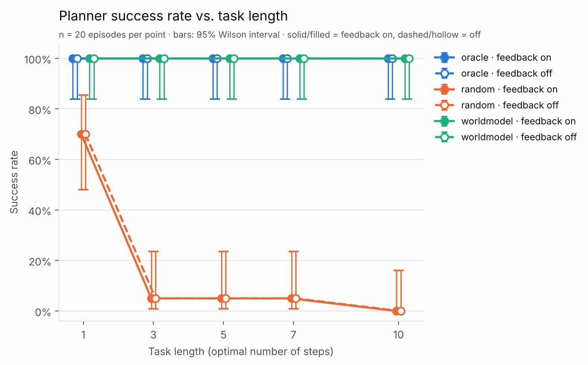

# gridworld-planner

## Where I left off

_Update this at the end of each session: date, what changed, what's next._

**2026-11-18**
- Added a **learned world model** planner (`worldmodel.py`, planner name `worldmodel`). It
  sees only the text observations, learns the rules itself, and plans in its learned model.
  See [The world model planner](#the-world-model-planner).
- Reran the baseline with it: 100% success at every task length, 0 failed actions. Optimal
  on the 1/3/5-step tasks; 11 steps on the 7-step task and 22 on the 10-step task, because
  it can't know a gate exists until it sees one.
- `--planners` now defaults to `random,oracle,worldmodel`. 47 tests.
- Next: unchanged (the LLM runs below). The world model is a third reference line between
  random and oracle that, like the LLM, sees only text.

**2026-11-16**
- Built the planner interface (random, oracle, LLM), the evaluation script, and the plot.
- Ran the **baseline only**: random and oracle, 20 episodes per task per condition
  (`results/results.csv`, `results/success_vs_length.png`). Oracle solves 100% at every task
  length; random falls from 70% on the 1-step task to 0–5% on the longer ones.
- **The LLM planner has not been run against a real model yet.** It has only been tested with
  fake backends in the unit tests.
- Next:
  1. Smoke-test the API backend on one task: `--planners llm --tasks walk_to_door --episodes 1`.
  2. Run a small pilot (`--episodes 3`), check the cost, then the full run.
  3. Try the local backend (Ollama) and compare.

---

## What this project tests

Two questions:

1. **Do LLM planners fail more often as tasks get longer?** The five tasks need 1, 3, 5, 7
   and 10 steps when solved optimally. Each one adds a step to the chain:
   walk to a door → fetch a key first → unlock and pass through → press a switch first →
   do all of it across two rooms.
2. **Does failure feedback help?** With feedback on, after an action that has no effect
   (bumping into a wall, using a locked door without the key, pressing a switch that's
   already on…), the next prompt starts with a line like
   `Feedback: Your last action "up" failed: You bump into the wall.`
   With feedback off, the model only sees the next observation and has to notice for itself
   that nothing changed.

Two reference planners bracket the LLM: **oracle** (reads the full map and plans the
shortest solution, so it is the ceiling) and **random** (uniform random actions, the floor).
A third, **worldmodel**, has the same information as the LLM (text observations only) and
isn't told the rules either. It learns them and plans with them. That shows what a
text-only agent with an explicit world model can do.

## Setup

Python 3.11+.

```bash
cd gridworld-planner
pip install -e ".[all]"     # anthropic (API backend) + matplotlib (plot)
python -m unittest          # 47 tests, no network or API key needed
```

Extras: `.[api]` for the API backend only, `.[plot]` for plotting only. The core gridworld,
the random, oracle and world model planners, and the local backend use only the standard library.

### Choosing the LLM: one setting in `config.toml`

```toml
[llm]
backend = "api"     # or "local"
```

- **`api`**: the Claude API through the Anthropic SDK. Set `ANTHROPIC_API_KEY` (or log in with
  `ant auth login`). The model, effort and so on are under `[llm.api]`. The default is
  `claude-opus-5-5` at effort `medium`.
  `fallbacks = true` turns on the API's server-side refusal fallback: if the model declines
  a request, a fallback model answers instead. The model that actually answered is logged in
  the CSV's `model` column. Set `fallbacks = false` if you want only the configured model
  in your results.
- **`local`**: any model served by [Ollama](https://ollama.com) (`ollama serve`, then
  `ollama pull llama3.1:8b`). The model, URL and temperature are under `[llm.local]`.
  The episode seed is passed to Ollama, so local runs are reproducible.

`--backend api|local` on the evaluation script overrides the file for one run.

## The gridworld

`#` wall · `.` floor · `k` key · `D` locked door · `s` switch · `X` gate (opened by the
switch) · `G` goal. Actions: `up down left right pick_up use`. Moving also turns the agent
to face that direction. `pick_up` picks up a key from the agent's own square. `use` presses
a switch the agent is standing on, or unlocks the door the agent is facing if it holds a key
(the key is used up).

Each observation is text: position and facing, what the agent holds, the four neighbouring
squares, and objects within 2 squares. The agent never sees the whole map.

## Tasks

| task | optimal steps | step limit | success |
|---|---|---|---|
| `walk_to_door` | 1 | 5 | facing the door |
| `key_then_door` | 3 | 10 | holding the key and facing the door |
| `unlock_and_pass` | 5 | 15 | reached the goal behind the locked door |
| `switch_key_door` | 7 | 20 | reached the goal (starts on the switch; key → door → gate → goal) |
| `two_room_chain` | 10 | 30 | reached the goal (switch and key in room 1, gate in room 2) |

The tests prove each task is solvable in exactly that many steps and no fewer
(`tests/test_tasks.py`).

To watch the oracle solve a task, or play it yourself:

```bash
python -m gridworld_planner --task two_room_chain
python -m gridworld_planner --task two_room_chain --play
```

## Running the evaluation

```bash
# Baseline (random, oracle, worldmodel): free and fast
python -m gridworld_planner.evaluate --episodes 20

# LLM: start tiny, check the cost, then scale up
python -m gridworld_planner.evaluate --planners llm --tasks walk_to_door --episodes 1 --out results/smoke.csv
python -m gridworld_planner.evaluate --planners llm --episodes 3 --out results/llm.csv
python -m gridworld_planner.evaluate --planners llm --episodes 20 --out results/llm.csv --resume

# Local model instead
python -m gridworld_planner.evaluate --planners llm --backend local --episodes 20 --out results/local.csv

# Everything in one CSV and one plot
python -m gridworld_planner.evaluate --planners random,oracle,worldmodel,llm --episodes 20
```

The script runs every combination of planner × feedback (on and off) × task × episode.
Useful flags: `--feedback on|off|both`, `--tasks a,b`, `--out`, `--plot` (`''` to skip),
`--resume`.

- Each episode is written to the CSV as soon as it finishes. If a run is interrupted, rerun
  it with `--resume` to skip the episodes already logged.
- **The LLM planner only runs when you name it in `--planners`**, so nothing costs money by
  accident.
- **Cost of an API run:** one LLM call per step, and each call resends the episode so far.
  The history only grows, so prompt caching keeps the repeated part cheap. A full run is
  5 tasks × 2 feedback conditions × N episodes, and each episode takes up to its step limit
  (5–30 calls). Measure the cost on the `--episodes 1` smoke test before a big run.
- **Seeds:** episode *i* of a task uses seed `task.seed * 1000 + i`, the same for every
  planner and condition. The gridworld itself has no randomness. The seed drives the random
  planner and Ollama's sampling. The Claude API has no seed parameter, so API runs vary
  from run to run.

### CSV columns

`task, optimal_steps, planner, feedback, episode, seed, success, steps_used, max_steps,
failed_actions, invalid_replies, model`

- `planner` is `random`, `oracle`, `worldmodel` or `llm:<backend>:<model>`.
- `failed_actions` counts actions that had no effect.
- `invalid_replies` counts LLM replies with no parseable `ACTION:` line. Each one still
  uses a step.
- `model` is the model(s) that actually answered, joined with `|` if a fallback happened.

To redraw the plot from any CSV: `python -m gridworld_planner.plot results/llm.csv results/llm.png`.

## Reading the plot



- **x-axis:** task length, the optimal number of steps (1, 3, 5, 7, 10).
- **y-axis:** the share of episodes that met the task's success check within its step limit.
- **One line per condition:** colour shows the planner. Solid lines with filled markers have
  feedback on; dashed lines with hollow markers have feedback off. Points are nudged
  sideways slightly so the error bars don't overlap. All points at one task length are the
  same tasks.
- **Error bars:** 95% Wilson score intervals. With n = 20, an interval is roughly ±20
  points around 50%. When two conditions' bars overlap a lot, the difference is likely noise:
  run more episodes before drawing conclusions.
- **What to look for:**
  - **Question 1:** does the LLM line slope down as tasks get longer? Compare it with
    oracle (the ceiling) and random (the floor).
  - **Question 2:** for the same planner, is the solid line above the dashed one? A gap that
    grows with task length would mean feedback matters more on longer tasks.
  - For random, oracle and worldmodel the two lines overlap, because they ignore feedback.
    That makes them a sanity check. (The world model notices failed actions itself: what it
    observes doesn't match what it predicted.)

## The world model planner

`gridworld_planner/worldmodel.py`. It gets exactly what the LLM gets, the text observation
each step, but no rules. Its three parts:

1. **Belief map.** Each observation is parsed into absolute map cells: the agent's square
   and its 4 neighbours (always named), objects within 2 squares (named), and the rest of
   that 5×5 window, known only to be "wall or floor" (the observation doesn't list plain
   tiles). It keeps the map for the whole episode. When the model predicts an effect it
   can't see, such as a gate opening out of view, the map is updated by dead reckoning.
2. **Learned transition model.** Every step is logged as
   `(action, tile here, tile ahead, items held) → effect`. The effect is a symbolic diff:
   moved or not, which tile changed into what, items gained or lost, and *global* changes
   such as "every closed gate became an open gate". For each action the model fits a small
   decision tree, so it learns which features matter and generalises to new situations.
   Hypotheses are scored by **consistency**: an observation with no gate in view can't
   refute "the switch opens gates". If a change is noticed late (a gate seen closed, then
   later seen open), it is **credited back** to the earlier action that seemed to do
   nothing.
3. **Planning in imagination.** Dijkstra search over imagined states, with the learned model
   as the simulator. Unknown cells are assumed walkable but cost a little extra. If the goal
   hasn't been seen yet, the agent goes for the most new map per step. It replans every
   step, so a wrong guess is corrected straight away.

It is **pretrained** by curiosity-driven exploration of three training maps (not the task
maps): untried action/situation pairs and unseen cells count as reward. Every evaluation
episode starts from a copy of that pretrained model and keeps learning within the episode.
That keeps episodes independent. The planner is deterministic, so all 20 episodes of a task
are identical.

To see what it learned, its prediction accuracy on the task maps, and a solve step by step:

```bash
python -m gridworld_planner.worldmodel                         # learned rules + one-step accuracy
python -m gridworld_planner.worldmodel --task two_room_chain   # belief map before every step
```

The learned rules match the real ones, for example:

```
use:
  split on here
    here = floor: split on target
      target = locked door: split on holding
        holding = key: -> ahead becomes open door, lose key
        holding = nothing: -> nothing happens
    here = switch: -> every closed gate becomes open gate
```

One-step prediction accuracy on the five task maps (never seen in training), random
actions: 705/705.

| task | optimal | worldmodel steps | why the extra steps |
|---|---|---|---|
| `walk_to_door` | 1 | 1 | |
| `key_then_door` | 3 | 3 | |
| `unlock_and_pass` | 5 | 5 | |
| `switch_key_door` | 7 | 11 | the gate is out of view, so it opens the door first, sees the closed gate, walks back to the switch |
| `two_room_chain` | 10 | 22 | same, plus a few steps exploring room 1 before it knows where the goal is |

The extra steps are the cost of partial observability, not of model errors: there are no
failed actions. The oracle sees the whole map from the start.

## Project layout

```
config.toml                  LLM backend switch and settings
gridworld_planner/
  env.py                     gridworld, text observations, failure flag per step
  tasks.py                   the five tasks (layout, seed, success check, step limit)
  planner.py                 BFS shortest-path search (used by the oracle and the tests)
  planners.py                Planner interface, random / oracle / LLM / world model planners, LLM prompt
  worldmodel.py              belief map, learned transition model, planning in imagination, pretraining
  llm.py                     config loading, API backend (Anthropic SDK), local backend (Ollama)
  runner.py                  runs one episode, applies feedback, returns a result row
  evaluate.py                N episodes × tasks × planners × feedback → CSV (+ plot)
  plot.py                    success rate vs task length with Wilson error bars → PNG
tests/                       unit tests (fake LLM backends; no network)
results/                     CSVs and plots
```
